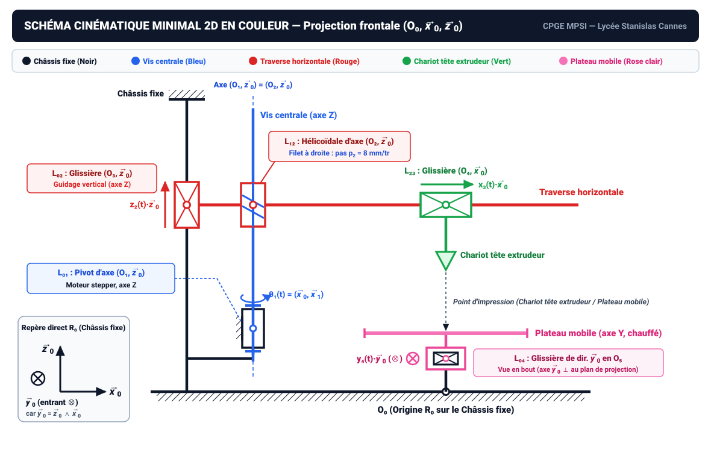
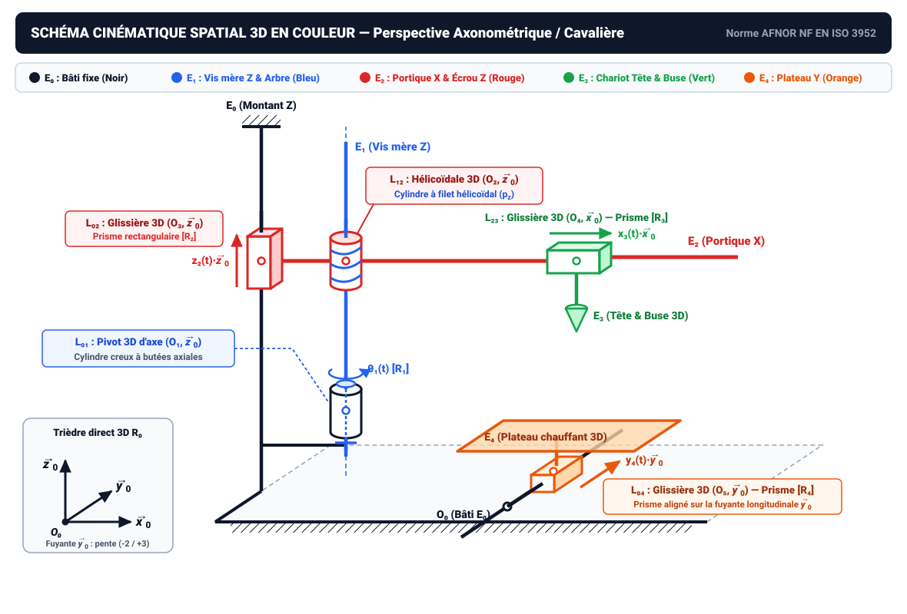

# Guide de Tracé des Schémas Cinématiques 2D et 3D en Couleur

**Système étudié :** Imprimante 3D Creality Ender 3  
**Matière :** Sciences Industrielles de l'Ingénieur (SII) — CPGE MPSI (Lycée Stanislas Cannes)  
**Professeur :** Mme M. Prot

---

## 1. Convention de couleurs (1 couleur = 1 sous-ensemble)

| Sous-ensemble | Description | Couleur de tracé | Repère local lié |
| :--- | :--- | :--- | :--- |
| **Châssis fixe** | Châssis d'aluminium, contient l'électronique entre autres | **Noir** (`#0f172a`) | $\mathcal{R}_0(O_0, \vec{x}_0, \vec{y}_0, \vec{z}_0)$ |
| **Vis centrale** | Moteur stepper, axe $Z$ | **Bleu** (`#2563eb`) | $\mathcal{R}_1(O_1, \vec{x}_1, \vec{y}_1, \vec{z}_0)$ |
| **Traverse horizontale** | Bouge de haut en bas (axe $Z$) et tient l'extrudeur | **Rouge** (`#dc2626`) | $\mathcal{R}_2(O_3, \vec{x}_0, \vec{y}_0, \vec{z}_0)$ |
| **Chariot tête extrudeur** | Bouge sur l'axe $X$ (droite / gauche) | **Vert** (`#16a34a`) | $\mathcal{R}_3(O_4, \vec{x}_0, \vec{y}_0, \vec{z}_0)$ |
| **Plateau mobile** | Bouge sur l'axe $Y$, il est chauffé | **Rose clair** (`#f472b6`) | $\mathcal{R}_4(O_5, \vec{x}_0, \vec{y}_0, \vec{z}_0)$ |

---

## 2. Schéma Cinématique Minimal 2D en Couleur — Vue Frontale $(O_0, \vec{x}_0, \vec{z}_0)$

- **Trièdre direct $\mathcal{R}_0$ en projection plane :** Avec $\vec{x}_0$ vers la droite et $\vec{z}_0$ vers le haut, le vecteur $\vec{y}_0 = \vec{z}_0 \wedge \vec{x}_0$ est **entrant dans la feuille** ($\otimes\,\vec{y}_0$).
- **Éléments représentés :**
  1. **Châssis fixe (Noir)** : ligne de base et montant vertical avec hachures de bâti, corps du pivot en $O_1$, et section du rail $Y$ vue en bout en $O_5$.
  2. **Vis centrale (Bleu)** : tige verticale d'axe $(O_1, \vec{z}_0)$ avec arrêts axiaux en $O_1$ et filetage en $O_2$.
  3. **Traverse horizontale (Rouge)** : coulisseau vertical en $O_3$ (croix interne), corps de l'écrou hélicoïdal en $O_2$, et poutre horizontale selon $\vec{x}_0$.
  4. **Chariot tête extrudeur (Vert)** : coulisseau horizontal en $O_4$ (croix interne) et buse pointant vers le plateau.
  5. **Plateau mobile (Rose clair)** : coulisseau entourant le rail en $O_5$ et plateau chauffant horizontal.

---

## 3. Schéma Cinématique Spatial 3D en Couleur — Perspective Axonométrique / Cavalière

- **Perspective cavalière :** Le plan frontal $(O_0, \vec{x}_0, \vec{z}_0)$ est en vraie grandeur ; l'axe de profondeur $\vec{y}_0$ suit la fuyante de pente $-2/+3$ ($\alpha \approx 34^\circ$).
- **Symboles 3D :**
  - **$L_{01}$ (Pivot)** : cylindre creux noir + arbre et butées bleus.
  - **$L_{12}$ (Hélicoïdale)** : cylindre rouge + tige et spires hélicoïdales bleues.
  - **$L_{02}$ (Glissière $Z$)** : prisme rectangulaire rouge coulissant sur le montant noir.
  - **$L_{23}$ (Glissière $X$)** : prisme rectangulaire vert coulissant sur la traverse horizontale rouge.
  - **$L_{04}$ (Glissière $Y$)** : prisme rectangulaire rose clair coulissant sur le rail noir orienté selon la fuyante $\vec{y}_0$, surmonté du plateau mobile chauffé rose clair.
