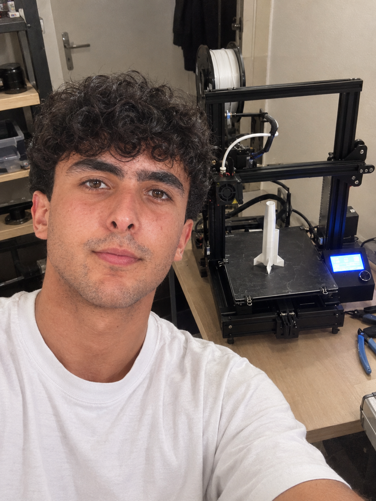
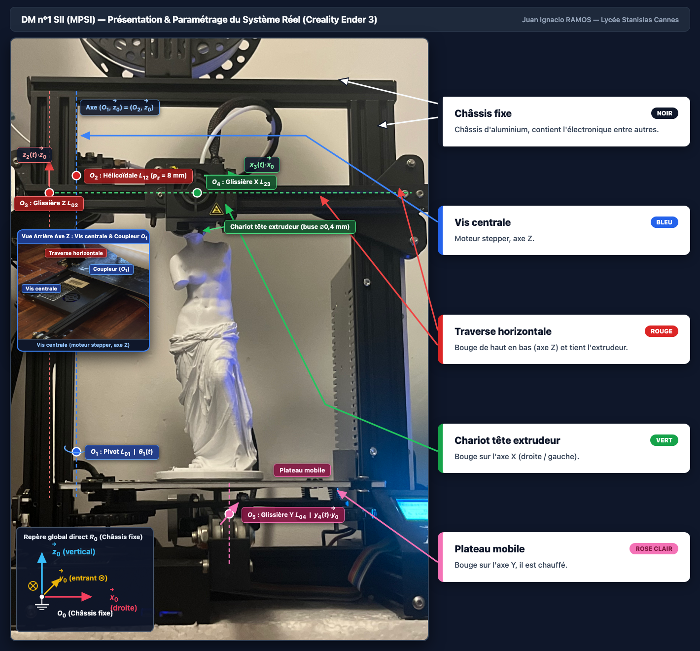
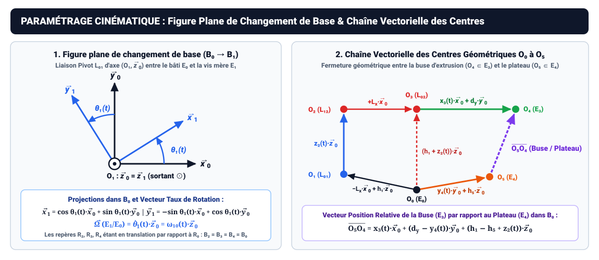
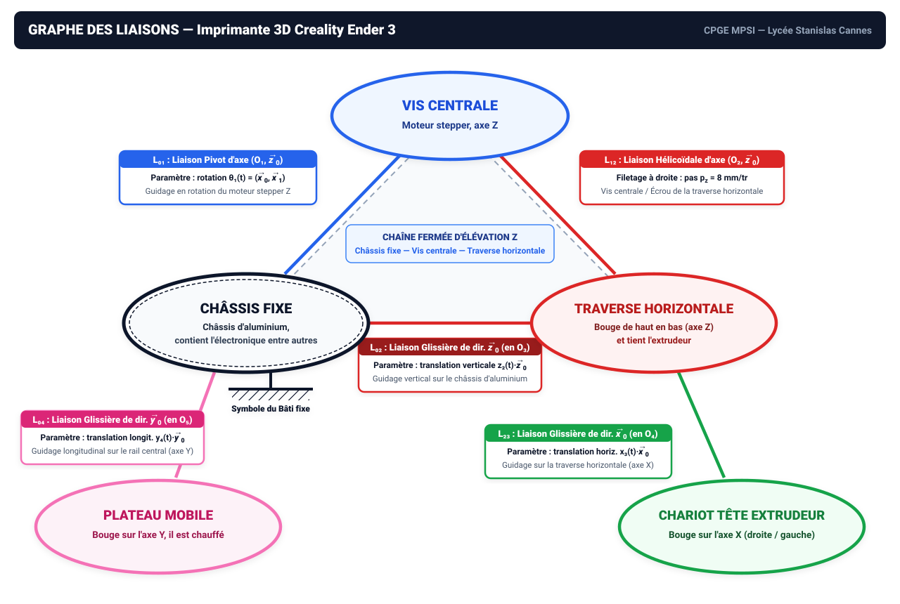

# DM n°1 — Modélisation des Liaisons et Schématisation Cinématique (Dossier Papier Complet)

- **Nom :** RAMOS
- **Prénom :** Juan Ignacio
- **Classe :** CPGE MPSI — Lycée Stanislas Cannes
- **Professeur :** Mme M. Prot
- **Matière :** Sciences Industrielles de l'Ingénieur (SII) — Cinématique du Solide Indéformable
- **Système étudié :** Imprimante 3D à dépôt de fil fondu (FDM) **Creality Ender 3**
- **Livrables associés :** [`DM1_Feuille_Rendu_Imprimable.html`](DM1_Feuille_Rendu_Imprimable.html) | [`DM1_Feuille_Rendu_Imprimable.pdf`](DM1_Feuille_Rendu_Imprimable.pdf) | [`diagrams_reference.html`](../diagrams_reference.html)

---

## 1. Présentation Photographique et Repérage du Système

### 1.1. Photo de validation de l'élève avec le système (`RAMOS-Selfie.png`)
La photographie atteste de la prise en main effective du système réel personnel de l'élève.

### 1.2. Photo détaillée du système annoté avec les 5 sous-ensembles (`RAMOS-Ender3-Details.png`)
La planche photographique ci-dessous présente l'imprimante Creality Ender 3 en phase d'impression nominale (modèle de la *Vénus de Milo*), munie d'une loupe arrière sur l'axe $Z$ (vis centrale Tr8x8, coupleur aluminium et moteur stepper $Z$). Y sont repérés le repère global orthonormé direct $\mathcal{R}_0$, les centres géométriques $O_1 \dots O_5$, les paramètres cinématiques et le pointage fléché des 5 sous-ensembles : **Châssis fixe**, **Vis centrale**, **Traverse horizontale**, **Chariot tête extrudeur** et **Plateau mobile**.

---

## 2. Repères Locaux ($\mathcal{R}_0$ à $\mathcal{R}_4$), Paramétrage Géométrique et Chaîne des Centres

### 2.1. Définition du repère global $\mathcal{R}_0$ et des 4 repères locaux mobiles ($\mathcal{R}_1, \mathcal{R}_2, \mathcal{R}_3, \mathcal{R}_4$)

À chaque sous-ensemble cinématique est attaché un **repère local orthonormé direct** $\mathcal{R}_k(O_{k}, \vec{x}_k, \vec{y}_k, \vec{z}_k)$ :

| Sous-ensemble | Couleur | Repère local lié | Origine géométrique | Base orthonormée directe associée | Paramètre cinématique / $\mathcal{R}_0$ |
| :--- | :--- | :--- | :--- | :--- | :--- |
| **Châssis fixe** | **Noir** (`#0f172a`) | $\mathcal{R}_0(O_0, \mathcal{B}_0)$ | $O_0$ : base médiane du rail $Y$ | $\mathcal{B}_0 = (\vec{x}_0, \vec{y}_0, \vec{z}_0)$ fixe | Référence fixe ($\underline{\underline{\equiv\mkern-10mu\perp}}$) |
| **Vis centrale** | **Bleu** (`#2563eb`) | $\mathcal{R}_1(O_1, \mathcal{B}_1)$ | $O_1$ : centre du coupleur $Z$ ($L_{01}$) | $\mathcal{B}_1 = (\vec{x}_1, \vec{y}_1, \vec{z}_0)$ tournante | Rotation $\theta_1(t) = (\widehat{\vec{x}_0, \vec{x}_1})$ autour de $\vec{z}_0$ |
| **Traverse horizontale** | **Rouge** (`#dc2626`) | $\mathcal{R}_2(O_3, \mathcal{B}_2)$ | $O_3$ : centre du guidage $Z$ ($L_{02}$) | $\mathcal{B}_2 = \mathcal{B}_0 = (\vec{x}_0, \vec{y}_0, \vec{z}_0)$ | Translation verticale $z_2(t)\,\vec{z}_0$ / $\mathcal{R}_0$ |
| **Chariot tête extrudeur** | **Vert** (`#16a34a`) | $\mathcal{R}_3(O_4, \mathcal{B}_3)$ | $O_4$ : centre du chariot $X$ / buse ($L_{23}$) | $\mathcal{B}_3 = \mathcal{B}_0 = (\vec{x}_0, \vec{y}_0, \vec{z}_0)$ | Translation horizontale $x_3(t)\,\vec{x}_0$ / $\mathcal{R}_2$ |
| **Plateau mobile** | **Rose clair** (`#f472b6`) | $\mathcal{R}_4(O_5, \mathcal{B}_4)$ | $O_5$ : centre du chariot plateau $Y$ ($L_{04}$) | $\mathcal{B}_4 = \mathcal{B}_0 = (\vec{x}_0, \vec{y}_0, \vec{z}_0)$ | Translation longitudinale $y_4(t)\,\vec{y}_0$ / $\mathcal{R}_0$ |

- **Orientation directe du trièdre de référence $\mathcal{B}_0(\vec{x}_0, \vec{y}_0, \vec{z}_0)$ :**
  - $\vec{x}_0$ : horizontal transversal, orienté de la gauche vers la droite en vue de face.
  - $\vec{z}_0$ : vertical ascendant, colinéaire aux montants verticaux et à la vis centrale.
  - $\vec{y}_0 = \vec{z}_0 \wedge \vec{x}_0$ : horizontal longitudinal, orienté de l'avant vers l'arrière de la machine.  
    > En projection frontale dans le plan $(O_0, \vec{x}_0, \vec{z}_0)$ ($\vec{x}_0$ vers la droite, $\vec{z}_0$ vers le haut), le vecteur $\vec{y}_0$ est **entrant dans la feuille** ($\otimes\,\vec{y}_0$).

- **Figure plane de changement de base ($\mathcal{B}_0 \to \mathcal{B}_1$) & Formule de Bour :**
  $$\begin{cases}
  \vec{x}_1 = \cos\theta_1(t)\,\vec{x}_0 + \sin\theta_1(t)\,\vec{y}_0 \\
  \vec{y}_1 = -\sin\theta_1(t)\,\vec{x}_0 + \cos\theta_1(t)\,\vec{y}_0 \\
  \vec{z}_1 = \vec{z}_0
  \end{cases}
  \quad \Longrightarrow \quad
  \vec{\Omega}(\text{Vis}/\text{Châssis}) = \dot{\theta}_1(t)\,\vec{z}_0 = \omega_{10}(t)\,\vec{z}_0$$

### 2.2. Vecteurs position des centres géométriques ($O_1$ à $O_5$) et chaîne vectorielle
- $\overrightarrow{O_0 O_1} = -L_x\,\vec{x}_0 + h_1\,\vec{z}_0$ (centre du pivot $L_{01}$ sur l'axe de la vis centrale, avec $L_x = 125\text{ mm}$, $h_1 = 45\text{ mm}$).
- $\overrightarrow{O_1 O_2} = z_2(t)\,\vec{z}_0 \implies \overrightarrow{O_0 O_2} = -L_x\,\vec{x}_0 + \big(h_1 + z_2(t)\big)\,\vec{z}_0$ (centre de l'écrou laiton $L_{12}$).
- $\overrightarrow{O_2 O_3} = +L_x\,\vec{x}_0 \implies \overrightarrow{O_0 O_3} = \big(h_1 + z_2(t)\big)\,\vec{z}_0$ (centre de la glissière équivalente $L_{02}$).
- $\overrightarrow{O_3 O_4} = x_3(t)\,\vec{x}_0 + d_y\,\vec{y}_0 \implies \overrightarrow{O_0 O_4} = x_3(t)\,\vec{x}_0 + d_y\,\vec{y}_0 + \big(h_1 + z_2(t)\big)\,\vec{z}_0$ (centre du chariot tête extrudeur $O_4$, avec $d_y = -25\text{ mm}$).
- $\overrightarrow{O_0 O_5} = y_4(t)\,\vec{y}_0 + h_5\,\vec{z}_0$ (centre du plateau mobile $O_5$, avec $h_5 = 45\text{ mm}$).

### 2.3. Fermeture géométrique : Vecteur position relative Buse / Plateau ($\overrightarrow{O_5 O_4}$)
En utilisant la relation de Chasles :
$$\overrightarrow{O_5 O_4} = \overrightarrow{O_5 O_0} + \overrightarrow{O_0 O_3} + \overrightarrow{O_3 O_4} = -\overrightarrow{O_0 O_5} + \overrightarrow{O_0 O_3} + \overrightarrow{O_3 O_4}$$
$$\boxed{\overrightarrow{O_5 O_4} = x_3(t)\,\vec{x}_0 + \big(d_y - y_4(t)\big)\,\vec{y}_0 + \big(h_1 - h_5 + z_2(t)\big)\,\vec{z}_0}$$

Par dérivation vectorielle dans le repère $\mathcal{R}_4$ :
$$\boxed{\vec{V}(O_4 \in \text{Chariot} / \text{Plateau}) = \left.\frac{\mathrm{d}\overrightarrow{O_5 O_4}}{\mathrm{d}t}\right|_{\mathcal{B}_0} = \dot{x}_3(t)\,\vec{x}_0 - \dot{y}_4(t)\,\vec{y}_0 + \dot{z}_2(t)\,\vec{z}_0}$$

---

## 3. Description des 5 Sous-ensembles et Graphe des Liaisons

### 3.1. Les 5 sous-ensembles cinématiques

1. **Châssis fixe (Noir — Repère de référence $\mathcal{R}_0$ — Symbole $\underline{\underline{\equiv\mkern-10mu\perp}}$) :**
   *Châssis d'aluminium, contient l'électronique entre autres* (profilés aluminium V-Slot du cadre inférieur, rail central $Y$, montants verticaux $Z$, traverse supérieure, stators des moteurs stepper $Z$ et $Y$, alimentation 24 V, boîtier carte mère et écran LCD).

2. **Vis centrale (Bleu — Repère $\mathcal{R}_1$) :**
   *Moteur stepper, axe $Z$* (rotor et arbre de sortie du moteur stepper $Z$, coupleur rigide fendu en aluminium, vis centrale trapézoïdale en acier inoxydable Tr8x8 de pas $p_z = 8\text{ mm/tr}$).

3. **Traverse horizontale (Rouge — Repère $\mathcal{R}_2$) :**
   *Bouge de haut en bas (axe $Z$) et tient l'extrudeur* (profilé horizontal $X$, platines en acier gauche et droite, écrou trapézoïdal en laiton Tr8x8, galets de guidage vertical $Z$, moteurs stepper de l'axe $X$ et de l'extrudeur).

4. **Chariot tête extrudeur (Vert — Repère $\mathcal{R}_3$) :**
   *Bouge sur l'axe $X$ (droite / gauche)* (platine chariot $X$, 3 galets de guidage $X$, tête chaude complète avec radiateur rouge, bloc de chauffe, buse en laiton $\varnothing 0{,}4\text{ mm}$, carénage et ventilateurs).

5. **Plateau mobile (Rose clair — Repère $\mathcal{R}_4$) :**
   *Bouge sur l'axe $Y$, il est chauffé* (platine support $Y$, 4 galets de guidage sur le rail central $Y$, molettes de nivellement, plaque chauffante aluminium $235\times 235\text{ mm}$ et revêtement BuildTak).

### 3.2. Graphe des liaisons

---

## 4. Répertoire des Liaisons, Torseurs Cinématiques et Fermeture Cinématique

### 4.1. Tableau des 5 liaisons élémentaires et torseurs

| Liaison | Sous-ensembles | Famille & Réalisation technologique | DDL ($N_s / N_c$) | Torseur cinématique $\{\mathcal{V}\}$ exprimé dans $\mathcal{B}_0(\vec{x}_0, \vec{y}_0, \vec{z}_0)$ |
| :--- | :---: | :--- | :---: | :--- |
| **$L_{01}$** | Châssis fixe $\leftrightarrow$ Vis centrale | **Pivot** d'axe $(O_1, \vec{z}_0)$ Moteur stepper $Z$ + coupleur alu | $1\text{ DDL } (1\text{R}, 0\text{T})$ $N_c = 5$ • **Glisseur** | $\{\mathcal{V}(\text{Vis}/\text{Châssis})\} = \begin{Bmatrix} 0 & 0 \\ 0 & 0 \\ \omega_{10}(t) & 0 \end{Bmatrix}_{O_1, \mathcal{B}_0} = \left\{ \dot{\theta}_1(t)\,\vec{z}_0 \;;\; \vec{0} \right\}_{O_1}$ |
| **$L_{12}$** | Vis centrale $\leftrightarrow$ Traverse horizontale | **Hélicoïdale** d'axe $(O_2, \vec{z}_0)$ Vis Tr8x8 + écrou laiton, $p_z = 8\text{ mm/tr}$ | $1\text{ DDL couplé}$ $N_c = 5$ • **Hélicoïdal** | $\{\mathcal{V}(\text{Traverse}/\text{Vis})\} = \begin{Bmatrix} 0 & 0 \\ 0 & 0 \\ \omega_{21}(t) & v_{21}(t) \end{Bmatrix}_{O_2, \mathcal{B}_0}$ avec $v_{21}(t) = +\dfrac{p_z}{2\pi}\,\omega_{21}(t)$ |
| **$L_{02}$** | Châssis fixe $\leftrightarrow$ Traverse horizontale | **Glissière** de direction $\vec{z}_0$ (en $O_3$) Guidage vertical sur le châssis | $1\text{ DDL } (0\text{R}, 1\text{T})$ $N_c = 5$ • **Couple** | $\{\mathcal{V}(\text{Traverse}/\text{Châssis})\} = \begin{Bmatrix} 0 & 0 \\ 0 & 0 \\ 0 & \dot{z}_2(t) \end{Bmatrix}_{\forall P, \mathcal{B}_0} = \left\{ \vec{0} \;;\; V_z(t)\,\vec{z}_0 \right\}_{\forall P}$ |
| **$L_{23}$** | Traverse horizontale $\leftrightarrow$ Chariot tête extrudeur | **Glissière** de direction $\vec{x}_0$ (en $O_4$) Guidage horizontal sur la traverse | $1\text{ DDL } (0\text{R}, 1\text{T})$ $N_c = 5$ • **Couple** | $\{\mathcal{V}(\text{Chariot}/\text{Traverse})\} = \begin{Bmatrix} 0 & \dot{x}_3(t) \\ 0 & 0 \\ 0 & 0 \end{Bmatrix}_{\forall P, \mathcal{B}_0} = \left\{ \vec{0} \;;\; V_x(t)\,\vec{x}_0 \right\}_{\forall P}$ |
| **$L_{04}$** | Châssis fixe $\leftrightarrow$ Plateau mobile | **Glissière** de direction $\vec{y}_0$ (en $O_5$) Guidage longitudinal sur le rail $Y$ | $1\text{ DDL } (0\text{R}, 1\text{T})$ $N_c = 5$ • **Couple** | $\{\mathcal{V}(\text{Plateau}/\text{Châssis})\} = \begin{Bmatrix} 0 & 0 \\ 0 & \dot{y}_4(t) \\ 0 & 0 \end{Bmatrix}_{\forall P, \mathcal{B}_0} = \left\{ \vec{0} \;;\; V_y(t)\,\vec{y}_0 \right\}_{\forall P}$ |

### 4.2. Fermeture cinématique de la chaîne fermée $Z$ (Châssis fixe — Vis centrale — Traverse horizontale)

1. **Transport du torseur $\{\mathcal{V}(\text{Vis}/\text{Châssis})\}$ du point $O_1$ au point commun $O_2$ (Formule de Varignon) :**  
   $$\vec{V}(O_2 \in \text{Vis}/\text{Châssis}) = \vec{V}(O_1 \in \text{Vis}/\text{Châssis}) + \overrightarrow{O_2 O_1} \wedge \vec{\Omega}(\text{Vis}/\text{Châssis}) = \vec{0} + \big(-z_2(t)\,\vec{z}_0\big) \wedge \big(\omega_{10}(t)\,\vec{z}_0\big) = \vec{0}$$

2. **Équation de fermeture cinématique en $O_2$ :**
   $$\{\mathcal{V}(\text{Traverse}/\text{Châssis})\}_{O_2} = \{\mathcal{V}(\text{Traverse}/\text{Vis})\}_{O_2} + \{\mathcal{V}(\text{Vis}/\text{Châssis})\}_{O_2}$$
   $$\begin{Bmatrix} 0 & 0 \\ 0 & 0 \\ 0 & V_z(t) \end{Bmatrix}_{O_2, \mathcal{B}_0} = \begin{Bmatrix} 0 & 0 \\ 0 & 0 \\ \omega_{21}(t) & v_{21}(t) \end{Bmatrix}_{O_2, \mathcal{B}_0} + \begin{Bmatrix} 0 & 0 \\ 0 & 0 \\ \omega_{10}(t) & 0 \end{Bmatrix}_{O_2, \mathcal{B}_0}$$

3. **Résolution scalaire et loi d'entrée-sortie :**
   $$\begin{cases}
   \text{Résultante selon } \vec{z}_0 : & 0 = \omega_{21}(t) + \omega_{10}(t) \implies \omega_{21}(t) = -\omega_{10}(t) = -\dot{\theta}_1(t) \\[6pt]
   \text{Moment en } O_2\text{ selon } \vec{z}_0 : & V_z(t) = v_{21}(t) + 0 = +\dfrac{p_z}{2\pi}\,\omega_{21}(t)
   \end{cases}$$
   $$\boxed{V_z(t) = \dot{z}_2(t) = -\frac{p_z}{2\pi}\,\omega_{10}(t) = -\frac{p_z}{2\pi}\,\dot{\theta}_1(t) = +\frac{p_z}{2\pi}\,\omega_m(t)}$$
   où $\omega_m(t) = -\omega_{10}(t) > 0$ est la vitesse angulaire motrice de montée (rotation horaire de la vis vue de dessus).

---

## 5. Schéma Cinématique Minimal 2D en Couleur

---

## 6. Schéma Cinématique Spatial 3D en Couleur

